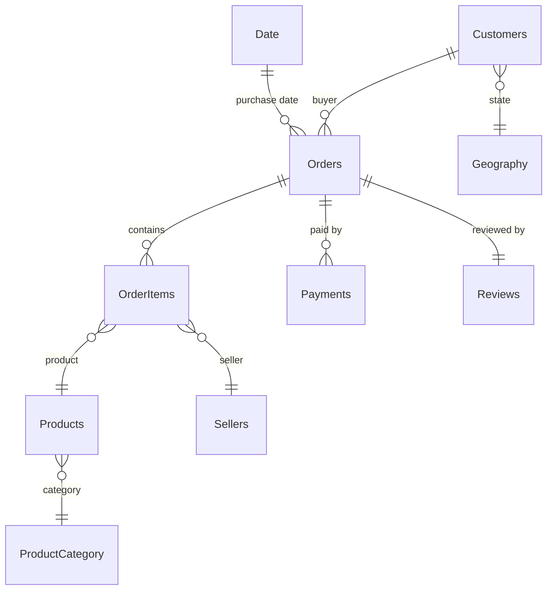

# Olist Commerce Performance

**eCommerce business performance · five-page Power BI dashboard · September 2016 – August 2018**


This repository turns 99,421 raw Olist marketplace orders into a five-page Power BI report. It covers the full path from data repair to a star-schema semantic model, 54 explicit DAX measures and an editorial report designed at 1920×1080.

The report answers five questions:

1. How big is the business, and is it still growing?
2. Who buys, and do they come back?
3. What do they buy, and which categories disappoint?
4. How do they pay?
5. How reliable is delivery, and what does lateness cost in reviews?

## At a glance

| Metric | Value |
|---|---:|
| Delivered revenue | **R$15,419,773.75** |
| Delivered orders | **96,478** |
| Average order value | **R$159.83** |
| Unique buyers | **96,090** |
| Lifetime repeat rate | **3.11%** |
| Average review score | **4.09 / 5** |
| Late rate — full window / 2018 YTD | **8.11% / 9.37%** |
| Credit-card value share | **78.37%** |
| Installment penetration | **66.85%** |

Revenue is delivered-only, includes price and freight, and is reported in Brazilian reais. The analysis window starts on 4 Sep 2016 and ends on 31 Aug 2018; 2016 is partial and 2018 is year-to-date. At-a-glance values use the full window; the page sections call out 2018 YTD where the default slicer changes the basis.

## The dashboard

Open **[`ecommerce_pbi.pbip`](ecommerce_pbi.pbip)** in Power BI Desktop. The report is local only — there is no Fabric publish.

The design language is an **editorial newsroom**: warm cream paper, white cards, one burnt-amber accent, Georgia headlines and oversized sans-serif KPI numerals. The canvas is a 12×12 grid with a 32px margin and 24px gutters. Every visual has alt text, and the palette passes WCAG AA contrast on white and cream.

| Page | Question it answers |
|---|---|
| [1. Overview](#1-overview) | How big is the business, and where did growth stall? |
| [2. Customers](#2-customers) | Is acquisition translating into retention? |
| [3. Products](#3-products) | Where is revenue concentrated, and where is satisfaction weak? |
| [4. Payments](#4-payments) | How is value paid, and do installments change spend? |
| [5. Delivery](#5-delivery) | Did reliability improve, and what does lateness do to reviews? |

## 1. Overview

**R$15.4M in 23 months — growth plateaued at ~R$1M a month**

<a href="assets/powerbi/01-overview.png"></a>

- Revenue reached **R$15.42M** across 96,478 delivered orders, at an average order value of **R$159.83**.
- Monthly revenue climbed to a **November 2017 peak** and then flattened near **R$1M a month**. The 3-month average makes the plateau clear.
- **São Paulo** alone contributes **R$5.8M** — about 37% of revenue. Rio de Janeiro (R$2.1M) and Minas Gerais (R$1.8M) follow.
- **Credit cards carry 78.4% of payment value**. Boleto is 17.9%, voucher 2.3% and debit card 1.4%.
- Health & beauty leads the full-period category ranking at **R$1.41M**, ahead of watches & gifts (R$1.26M) and bed, bath & table (R$1.23M).
- The insight panel carries the three cross-page findings: the revenue plateau, the 96.9% one-and-done rate and the review penalty for late delivery.

## 2. Customers

**96.9% of buyers never place a second order**

<a href="assets/powerbi/02-customers.png"></a>

- The report covers **96,090 unique buyers**. Only **2,987** ever place a second order — a **3.11% lifetime repeat rate**.
- **93,103 buyers place exactly one order**. The tail is thin: 2,739 place two, 199 place three, 30 place four and 19 place five or more.
- Average orders per buyer is **1.03**. Acquisition scaled; repeat purchasing did not.
- Average monthly active buyers were **4,262 across the full window**, rising to **6,671 in 2018 YTD**.
- The year table measures repeat purchasing **within the visible year**, not lifetime. That within-year retention is even lower: **1.3% in 2018**.
- The active-vs-new combo shows new buyers and active buyers moving together — growth came from acquisition, not from a widening returning base.

## 3. Products

**Health & beauty is the R$867K engine — bed & bath drags satisfaction**

<a href="assets/powerbi/03-products.png"></a>

- In 2018 YTD, **health & beauty** generates **R$866,810** — **10.3%** of delivered category revenue. Watches & gifts (R$749,738, 8.9%) and bed, bath & table (R$643,653, 7.6%) follow.
- The **top three categories account for 26.7%** of 2018 YTD revenue. Revenue is concentrated, but not overwhelmingly so.
- **Bed, bath & table is the satisfaction outlier**: R$643,653 of revenue but a **3.97 average review**, versus the **4.09** report average.
- Health & beauty scores **4.19**; watches & gifts **4.03**; sports & leisure **4.11**; computers & accessories **3.99**; housewares **4.15**.
- The scatter plots revenue against review score, with bubble size set to delivered orders. The category table adds revenue share, delivered orders, AOV, review score and cancellation rate for all 74 categories.
- The 2018 YTD cancellation rate is **0.6%**, but category-level differences are visible in the table.

## 4. Payments

**Credit cards carry 78% of value; boleto still owns one in five orders**

<a href="assets/powerbi/04-payments.png"></a>

- **R$8.69M** of payment value moves through the platform in 2018 YTD.
- **Credit cards are 78.9% of value** and **74.9% of payment records**. Boleto is **16.8% of value** and about **one in five payment records** (18.2%).
- Voucher and debit card remain small by value (2.3% and 2.0%) but are materially larger by count than by value.
- **64.0% of credit-card payments use installments**; the average credit-card payment runs **3.30 installments**.
- Installment buyers spend **2.13× more per payment** than single-installment buyers on credit cards. The bucket chart shows the gradient: **R$112.18** at one installment, **R$139.78** at 2–3, **R$192.52** at 4–6, **R$345.52** at 7–12 and **R$348.13** at 13+.
- Single-installment payments dominate volume (**29,120**), followed by 2–3 (12,527), 4–6 (8,371), 7–12 (5,887) and 13+ (90).

## 5. Delivery

**Late deliveries rose to 9.4% — and they score 2.58★ vs 4.30★**

<a href="assets/powerbi/05-delivery.png"></a>

- **9.37% of 2018 YTD deliveries arrive late**, up from **8.11% across the full window**. That is **4,945 late orders** in 2018.
- Average delivery time is **12.1 days**; when an order is late, it is late by **8.2 days** on average.
- Lateness is geographically uneven. The worst 2018 state rates are **Alagoas 24.1%**, **Maranhão 22.7%**, **Ceará 21.0%**, **Tocantins 19.4%** and **Piauí 18.6%**.
- Most deliveries land in **8–14 days** (19,002 orders), followed by 4–7 days (14,571), 15–21 days (8,017), 0–3 days (4,773), 22–30 days (3,952) and 30+ days (2,463).
- The review penalty is severe: **late deliveries average 2.58★**, versus **4.30★ on time**. Across the full window the comparison is 2.57★ vs 4.29★.
- The monthly combo shows the late-rate columns and average delivery days moving together through 2018; reliability did not improve as volume grew.

## What the five pages say together

1. **Growth was an acquisition story, not a retention story.** Revenue and buyers scaled, but 96.9% of buyers never return and average orders per buyer is 1.03. The plateau after November 2017 is consistent with a business that kept buying new customers without building a returning base.
2. **Revenue is concentrated, but satisfaction is not distributed evenly.** Health & beauty and watches & gifts carry the most value, while bed, bath & table and computers & accessories underperform on reviews. The category table turns that into a short list for quality review.
3. **Payments are card-led and installment-driven.** Credit cards dominate value, and installment buyers spend materially more per payment. Boleto remains important enough that checkout cannot treat it as an afterthought.
4. **Delivery reliability is the review lever.** Late orders score roughly 1.7 stars lower than on-time orders, and the worst rates sit in the Northeast. Promised-date accuracy and carrier performance are not operational details — they show up directly in customer satisfaction.

## Recommendations

- **Build a retention loop.** Use post-purchase engagement, personalised recommendations and a second-purchase incentive to attack the 96.9% one-and-done rate. Measure success with lifetime repeat rate and second-order conversion, not only MAU.
- **Fix the satisfaction outliers first.** Investigate bed, bath & table and computers & accessories — high revenue, below-average reviews. Audit product descriptions, quality signals and carrier handoffs for those categories.
- **Protect the health & beauty engine.** It is the largest 2018 category and scores above average. Treat it as the reference playbook for assortment and quality.
- **Manage delivery as a customer-experience metric.** Set state-level late-rate targets, review carrier performance in Alagoas, Maranhão and Ceará, and calibrate promised dates so on-time performance is not flattered by generous estimates.
- **Make installments legible at checkout.** Show the per-installment value and total cost clearly; the data shows installment buyers spend more per payment, but the report cannot tell us whether that is selection or uplift.
- **Keep boleto and debit card in the mix.** They are smaller by value but meaningful by count, and they serve customers who do not want a credit-card flow.

## Semantic model

The model is a star schema built in TMDL, not a set of raw CSV imports.



`OrderItems` is the **Order Items** table and `ProductCategory` is the **Product Category** table.

| Table | Grain | Rows |
|---|---|---:|
| Orders | one row per order | 99,421 |
| Order Items | one row per order item | 112,649 |
| Payments | one row per payment | 103,866 |
| Reviews | one row per order (latest review kept) | 98,654 |
| Customers | one row per person (`customer_unique_id`) | 96,090 |
| Products | one row per product | 32,951 |
| Sellers | one row per seller | 3,095 |
| Date | one row per day | 1,096 |
| Product Category | one row per category | 74 |
| Geography | one row per Brazilian state | 27 |

Model notes:

- **54 explicit measures** live in a dedicated `_Measures` table, grouped by display folder. Revenue, orders, AOV, customer, product, payment and delivery metrics are all defined in DAX.
- `Date` is marked as the date table; auto date/time is disabled and the auto-generated date tables are removed.
- There are **9 relationships**. Two are bidirectional by design:
  - `Reviews → Orders` is 1:1 and must filter in both directions.
  - `Order Items → Orders` is bidirectional so a product-category filter reaches order-level counts and reviews. Revenue and category/state roll-ups were checked after the change and still total **R$15,419,773.75**, so the extra direction does not double-count revenue.
- Keys and technical columns are hidden. `customers_dataset` is a hidden staging lookup; the model no longer exposes its `customer_id` or an auto-detected relationship.
- Revenue is reconciled before any visual work: **R$15,419,773.75** for delivered orders, price plus freight.

## Data quality and caveats

- **Delivered-only revenue.** Revenue uses orders with status `delivered` and sums item price plus freight. Cancelled, unavailable and in-flight orders are excluded. Payments include all statuses, so payment value and item revenue are not expected to reconcile.
- **Fixed window.** Source facts are filtered to **4 Sep 2016 – 31 Aug 2018**. September–October 2018 contains 20 noise orders and is excluded. 2016 is labelled partial; 2018 is labelled YTD.
- **Customer grain.** Buyers are keyed on `customer_unique_id`, not `customer_id`. This is what makes repeat-buyer analysis possible.
- **Review grain.** Reviews are deduplicated to one per order, keeping the latest `review_answer_timestamp`. The original data has 551 orders with two reviews.
- **Currency.** All monetary values are BRL. The original import parsed `58.90` as `5890` under an `en-ID` culture; the rebuild pins `en-US` and verifies the price sample.
- **Categories.** Null product categories are mapped to **Unknown** (610 products, 1.47% of items).
- **Geography.** The 1M-row geolocation table was removed (unused, corrupted coordinates). The Overview uses a top-10 state bar; Azure Maps was unavailable in the local tenant and required sign-in.
- **Static headlines.** Page titles and insight text are snapshot values for this fixed window. If the data is refreshed, the headline numbers should be updated with the measures.

## Repository and reproduction

```
ecommerce_pbi.pbip              open this in Power BI Desktop
ecommerce_pbi.SemanticModel/    TMDL star schema, relationships, 54 measures
ecommerce_pbi.Report/           PBIR pages, visuals, theme
scripts/pbip/                   deterministic Node generator for pages and visuals
assets/powerbi/                 final screenshots of the five pages
data/                           source CSV files
```

To open the report:

1. Open `ecommerce_pbi.pbip` in Power BI Desktop.
2. Refresh the model if prompted; the CSV sources are in `data/`.
3. Use the page tabs or the in-report navigation buttons. Products, Payments and Delivery default to **2018 YTD**; Customers defaults to **all years**; Overview defaults to **all states**.

To rebuild the page definitions from the generator:

```powershell
node scripts/pbip/build_report.mjs
powerbi-report-author validate "ecommerce_pbi.Report"
```

## Tools

Power BI Desktop (Store build) · PBIP / PBIR / TMDL · DAX · Power Query (M) · Node.js page generator · `powerbi-report-author` 0.5.0.

## Dataset and credit

Dataset: [Olist Brazilian E-Commerce Public Dataset](https://www.kaggle.com/datasets/olistbr/brazilian-ecommerce), 100k orders from 2016–2018 across multiple Brazilian marketplaces.

Analysis and report: **Muhammad Cikal Merdeka**.
